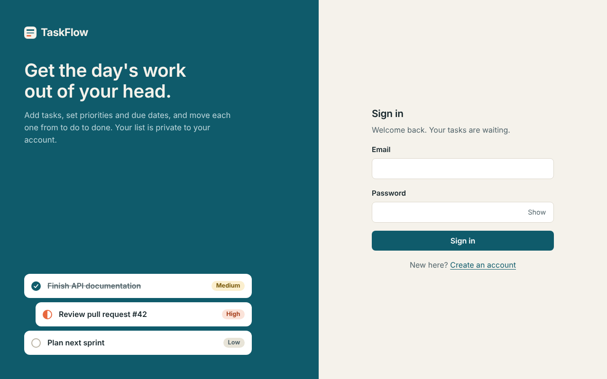
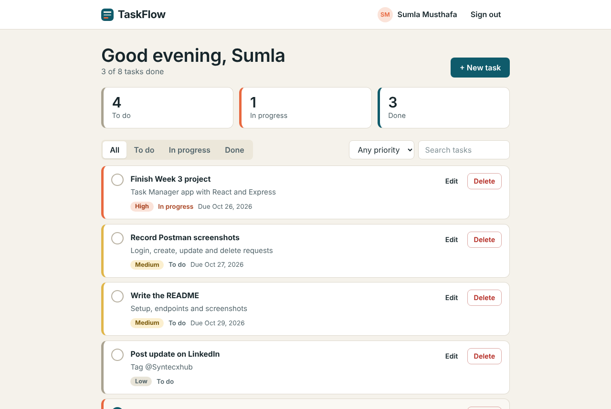
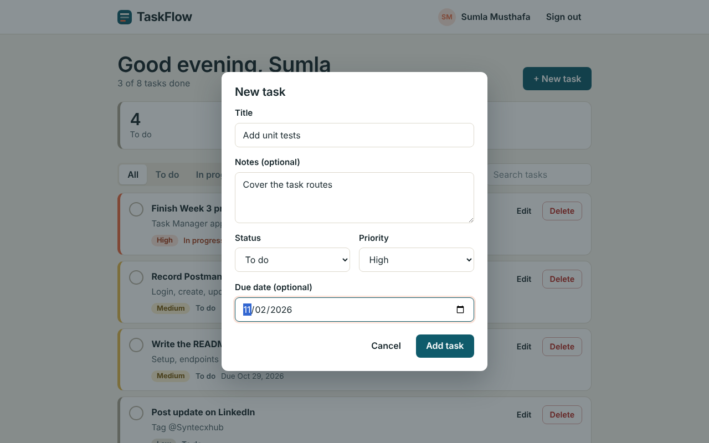
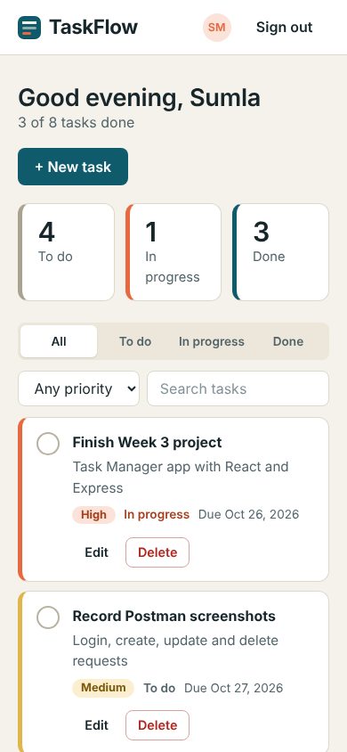

# Syntecxhub Task Manager App

A full-stack task manager built for the **Syntecxhub Web Development Internship (Task 3, Project 1)**.
Users create an account, sign in with JWT, and manage their own tasks: add, edit, delete, mark done, filter by status or priority, and search.

**Live app:** _add your frontend URL here_
**Live API:** _add your backend URL here_

## Features

- Register and sign in. Passwords are hashed with bcrypt, sessions use JWT.
- Create, read, update and delete tasks (title, notes, status, priority, due date).
- Every task route is protected by auth middleware, and each user can only see and change their own tasks.
- Filter by status or priority, search by title, paginated list, live counters for to do / in progress / done.
- Overdue tasks are highlighted. Responsive layout that works on phones.
- Validation and clear JSON errors, security headers (helmet), CORS and rate limiting.

## Tech stack

| Part | Tools |
|---|---|
| Frontend | React 19, Vite, React Router, plain CSS |
| Backend | Node.js, Express 5, Mongoose |
| Database | MongoDB Atlas |
| Auth | JWT (Bearer token), bcryptjs |
| Extras | helmet, cors, morgan, express-rate-limit |

## Screenshots

| Sign in | Tasks |
|---|---|
|  |  |

| New task | Mobile |
|---|---|
|  |  |

## API endpoints

Auth routes are public. Every `/api/tasks` route needs the header `Authorization: Bearer <token>`.

| Method | Endpoint | What it does |
|---|---|---|
| POST | `/api/auth/register` | Create an account, returns a token |
| POST | `/api/auth/login` | Sign in, returns a token |
| GET | `/api/auth/me` | Current user |
| GET | `/api/tasks` | List your tasks. Query: `status`, `priority`, `search`, `page`, `limit` |
| POST | `/api/tasks` | Create a task |
| GET | `/api/tasks/:id` | Get one task |
| PUT | `/api/tasks/:id` | Update a task |
| DELETE | `/api/tasks/:id` | Delete a task |
| GET | `/api/health` | Health check |

Task fields: `title` (required, max 100), `description` (max 500), `status` (`todo`, `in-progress`, `done`), `priority` (`low`, `medium`, `high`), `dueDate`.

Errors come back as `{ "message": "..." }` with the right status: 400 validation, 401 not signed in, 404 not found (also returned when a task belongs to someone else), 409 email already used, 429 too many requests.

## Run it locally

You need Node.js 20+ and a MongoDB Atlas connection string.

```bash
# 1. Backend
cd server
npm install
cp .env.example .env      # then fill in MONGO_URI and JWT_SECRET
npm run dev               # http://localhost:5000

# 2. Frontend (new terminal)
cd client
npm install
cp .env.example .env      # VITE_API_URL=http://localhost:5000
npm run dev               # http://localhost:5173
```

## Test the API with Postman

Import `postman/Task_Manager_API.postman_collection.json`, then run the requests in order. Login saves the token and Create task saves the task id, so the later requests work without copying anything. Each request has test scripts for the expected status codes.

## Deploy (Vercel)

Create two Vercel projects from this repo.

1. **API:** Root Directory `server`. Add the environment variables `MONGO_URI`, `JWT_SECRET`, `JWT_EXPIRES_IN`. In Atlas, allow `0.0.0.0/0` under Network Access.
2. **Frontend:** Root Directory `client`. Add `VITE_API_URL` set to the API URL (no trailing slash).

## Project structure

```
server/
  config/db.js              cached MongoDB connection
  models/                   User, Task
  controllers/              auth and task logic
  middleware/               JWT protect, errors, rate limiting
  routes/                   auth and task routes
  server.js
client/
  src/pages/                AuthPage, Tasks
  src/components/           Navbar, TaskDialog, ConfirmDialog, ...
  src/context/              auth state
  src/api.js                API helper
postman/                    Postman collection
screenshots/
```

## Author

MM Fathima Sumla, Syntecxhub Web Development Internship.
